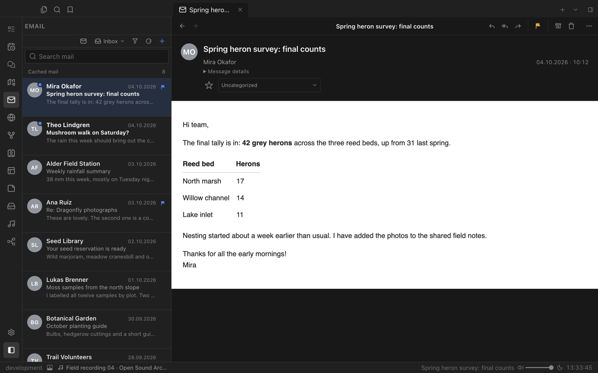
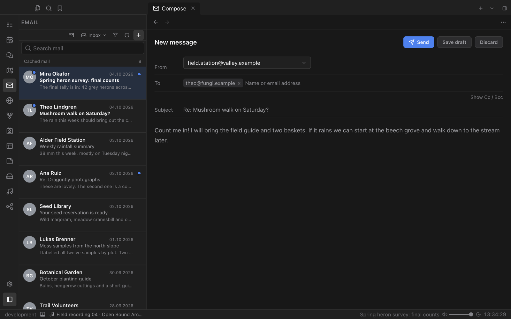

# Email

Your mail, inside your workspace. Read, search and write email next to your notes, with names and photos from your contacts and every synced message part of Valley's search.

## Read without switching apps

Accounts and folders live in the left sidebar, messages open in a full reader, and a preview is always available in the right sidebar. Rich HTML messages show at their full height in one scroll area, and remote images follow your per-account preference.

- Sign in to Gmail and Microsoft accounts once under Settings → Accounts, or add any IMAP/SMTP mailbox.
- Filter by contacts, VIP senders or categories.
- Flag, archive and file messages with the toolbar.

## Write in place

Compose opens as its own tab. Choose the sending account, add recipients, expand Cc and Bcc when you need them, and save drafts for later.

## Part of everything else

- **Search.** Subjects, senders and full message bodies appear in Valley's content search.
- **Contacts.** Senders show with their names and photos.
- **Groups.** Optional automatic grouping sorts new mail into your categories with a classification provider you choose. It is off until you turn it on and never moves messages.
- **Workflow.** Send messages and replies as part of an automation.
